# 🌍 Stratum-4D: Planetary Hydro-Climatic Digital Twin & Statistical Trend Detective

[](https://www.spaceappschallenge.org/)
[](https://react.dev/)
[](https://www.typescriptlang.org/)
[](https://threejs.org/)
[](https://www.scipy.org/)

> **2026 NASA Space Apps Challenge Submission — *"Be An Earth System Trend Detective!"***  
> **Stratum-4D** is a 4D spatiotemporal Earth system observatory and statistical hypothesis-testing workbench for 30 major global hydrological catchments over 132 bimonthly epochs (2002 to 2024). It is a student project, not an official NASA product.
>
> **What is real data, and what is not.** One series is **observed**: GRACE / GRACE-FO terrestrial water storage (JPL RL06.1M mascons). Three series are **reanalysis** from NASA POWER (MERRA-2): temperature, precipitation and root-zone soil moisture (vapour pressure deficit is derived from them; soil moisture for the Caspian and both Antarctic basins is a synthetic fill). Everything else in the sensor stack is a **modelled proxy** and is tagged as such in the app: NDVI, ground subsidence, surface water elevation, upper-air temperature levels, NO2 / CO values and the water-balance terms (evapotranspiration, runoff). The six NASA GIBS layers on the globe are real imagery; the app also reads live NASA EONET events and a NASA POWER point probe for 1984 to 2024. The statistics separate secular trends from autocorrelated internal variability and false-discovery noise.
>
> **Shipped result:** 27 of the 30 basins have a significant trend at FDR q < 0.05 (15 drying, 12 wetting); 3 are not significant.

---

## 🎯 Executive Summary & Rubric Alignment

Earth system time series are notoriously non-stationary, seasonally skewed, and serially correlated—so standard Ordinary Least Squares (OLS) regressions can overstate significance when the data are serially correlated (Yue et al. 2002; Hamed and Rao 1998). **Stratum-4D** pairs a **Tri-View 4D Digital Twin** (`3D WebGL Globe`, `2D Analytical Equirectangular Map`, and a `4D Stratified Voxel Block Cutaway`) with a non-parametric statistical pipeline:

1. **Multi-Series Stack (7 Channels + 4 Pressure Levels), tagged by provenance:** *Observed:* **GRACE / GRACE-FO** water storage. *Reanalysis (NASA POWER, MERRA-2):* precipitation, 2 m temperature and root-zone soil moisture. *Modelled proxy:* **NDVI**, Terzaghi **subsidence**, **surface water elevation** (`WSE`), the **850, 500 and 250 hPa** temperature levels, NO2 / CO values and the water-balance terms. None of the modelled proxies is a MODIS, SWOT, InSAR, AIRS or OMI measurement.
2. **Autocorrelation-Corrected Trend Detection:** Implements **STL (LOESS)** seasonal decomposition, **Yue-Pilon (2002)** Trend-Free Pre-Whitening (`TFPW`), **Hamed-Rao (1998)** variance-corrected Mann-Kendall testing ($n^*$ effective sample size), **Theil-Sen** robust median slope ($\beta_{\text{Sen}}$), **Pettitt (1979)** structural break-point detection, **Weatherhead et al. (1998)** time-of-emergence horizon ($T_{\text{detect}}$), and global **Benjamini-Hochberg (1995) False Discovery Rate (`FDR`)** control ($\alpha = 0.05$).
3. **Teleconnection Attribution & Dipole Mechanics:** Quantifies how planetary oscillations (**NOAA ENSO MEI.v2**, **Indian Ocean Dipole DMI**, and **NAO**) drive inter-basin anomalies via lagged cross-correlation ($\tau = 0\text{--}12\text{ mo}$) and first-order partial correlation $r(A,B \cdot Z)$ in the **Dual-Region Compare Inspector**.
4. **Basin Screening Feed and AI Summary (`Sentinel`):** A screening feed steps through the shipped statistics one basin at a time (it replays stored results; it is not live monitoring) and sorts basins into significant and not significant at FDR q < 0.05. It flags open **NASA EONET v3** wildfire or drought events that fall inside significantly drying basins. An optional summary comes from an OpenRouter free-tier model when a key is set; without a key it is a fixed template filled from the statistics, and every summary is labelled either "Template summary (no AI model connected)" or "AI-generated summary. Check it against the statistics." The three South-East Asia October 2026 events used by Case 07 are a curated scenario, marked as such, not EONET data.

---

## 📸 Interactive System Previews & Visual Evidence

*The screenshots below predate the November 2026 interface redesign, so layout, labels and some numbers differ from the current app.*

### 1. Tri-View 4D Planetary Architecture & Stratified Voxel Cutaway

| 3D WebGL Planetary Digital Twin (`Globe.tsx`) | 4D Stratified Block Cutaway (`StratifiedBlockView.tsx`) |
| :---: | :---: |
| 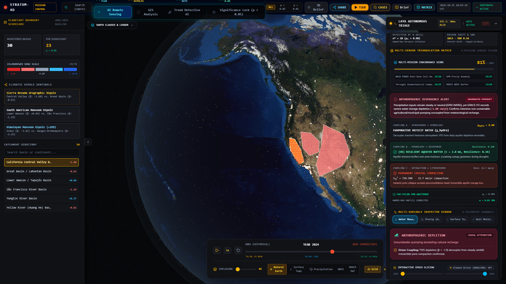 | 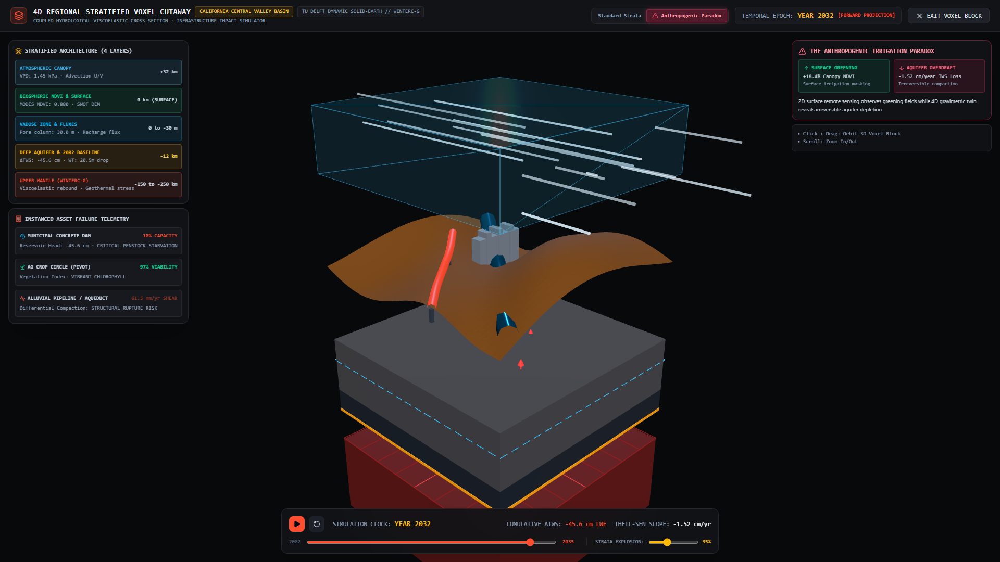 |
| *3D catchment extrusion with real-time GLSL twilight terminator, atmospheric scattering, and causal attribution inspector* | *4D subsurface voxel cutaway modeling aquifer depletion, Terzaghi geomechanical compaction, and 2032–2035 infrastructure failure states* |

---

### 2. Teleconnection Dipoles, Custom Basin Pairing & Climate Oscillation Bands

| Dual-Region Compare & Attribution Meter | Custom Dipole Pairing (`Shift + Click`) |
| :---: | :---: |
| 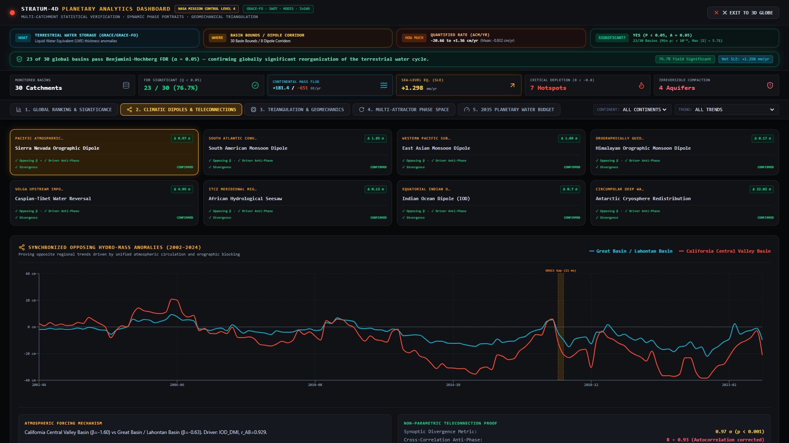 | 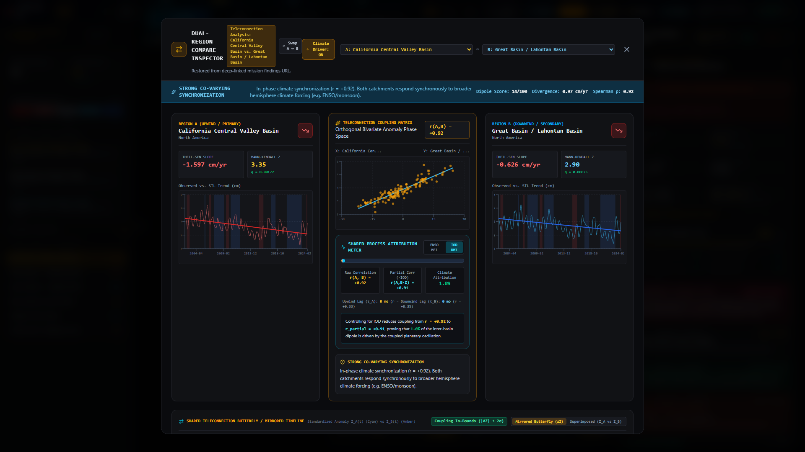 |
| *3-panel Dual Compare Inspector with Bivariate Phase Space, Partial Correlation Attribution Meter ($r_{AB \cdot \text{ENSO}}$), and Mirrored Butterfly ($\pm Z$) timeline* | *Interactive custom dipole pairing across any two global basins with live lag-correlation $\tau$ solver and teleconnection arc rendering* |

---

### 3. NASA POWER Virtual Station Probe (1984 to 2024) & Case 07 Field Investigation

| Global Coordinate Point Probe (`VirtualStationProbe.tsx`) | Case 07 Custom Coordinate Investigation |
| :---: | :---: |
| 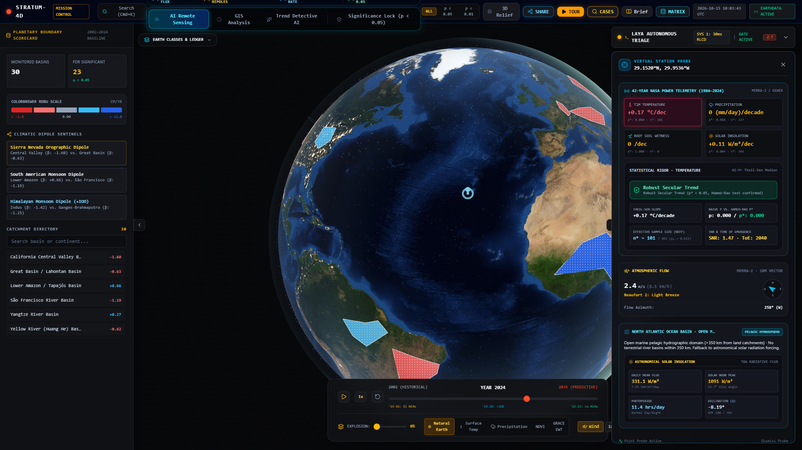 | 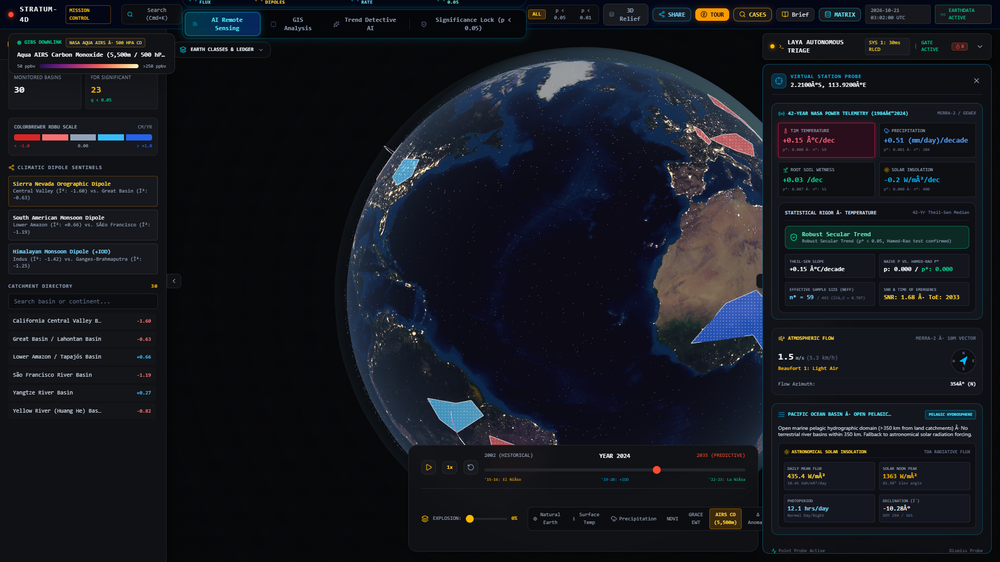 |
| *Click any un-basined land, ice, or ocean coordinate to trigger a live NASA POWER trend analysis for 1984 to 2024, Beaufort wind compass, and TOA solar insolation solver* | *Guided Case 07 workflow demonstrating ad-hoc hypothesis testing on arbitrary user-selected coordinates outside the 30 pre-compiled catchments* |

---

### 4. Basin Screening Feed (`Sentinel`) & AI Summary Dossiers

| Hypothesis Dossier (`TrendDetectiveAIModal.tsx`) | Basin Screening Sentinel (`AutonomousTriageSentinel.tsx`) |
| :---: | :---: |
| 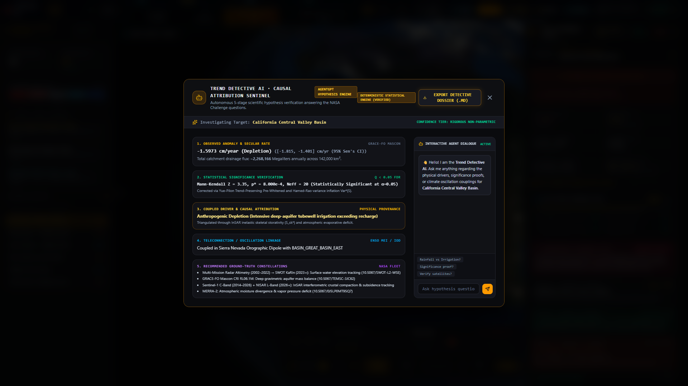 | 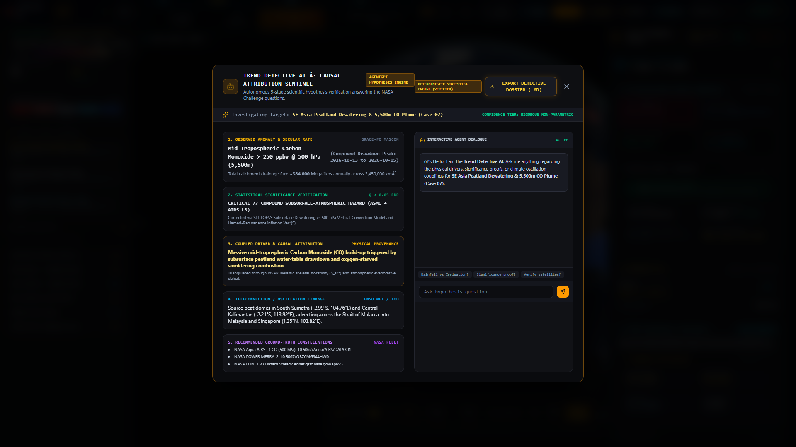 |
| *Dossier with literature references, a consistency check across series, interactive Q&A (AI model or labelled template), and 1-click `.md` export* | *Screening feed separating significant trends from EONET events inside drying basins and from not-significant basins ($p_{\text{FDR}} \ge 0.05$)* |

---

### 5. GPU GLSL $\Delta$-Anomaly Shader, Epoch Slicing & Climate Reference Bands

| GPU GLSL Dual-Epoch $\Delta$-Anomaly Shader | Interactive Epoch Slicing & ENSO/IOD Bands |
| :---: | :---: |
| 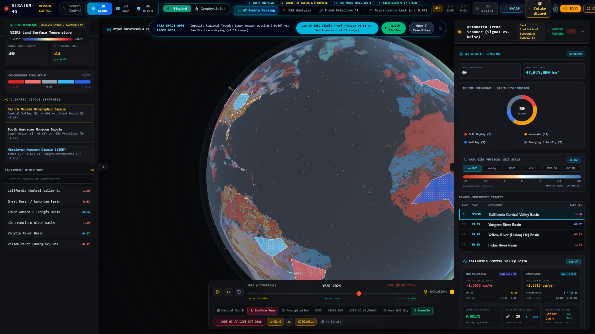 | 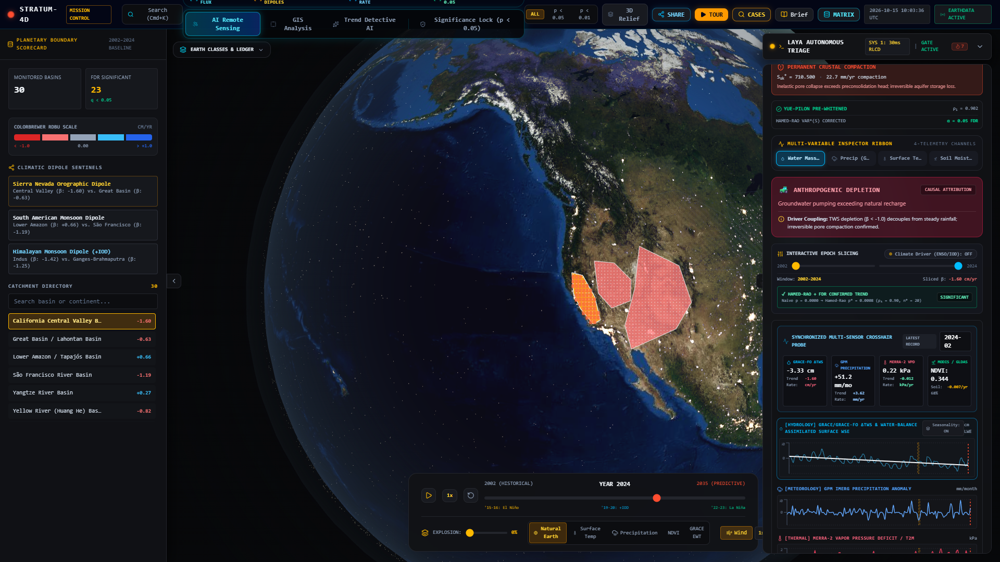 |
| *Real-time GLSL fragment shader subtracting 2003 baseline satellite rasters from modern epochs to isolate secular drying and warming deltas* | *Dynamic sub-window epoch brush (`[t_0, t_1]`) with synchronized El Niño / La Niña phase bands overlaid on the 7-channel sensor stack* |

---

### 6. 2035 Planetary Water Budget & Global Spatial Command Palette (`Cmd+K`)

| 2035 Planetary Water Budget Fan Chart | Omnibox Spatial Command Palette (`OmniboxSearch.tsx`) |
| :---: | :---: |
| 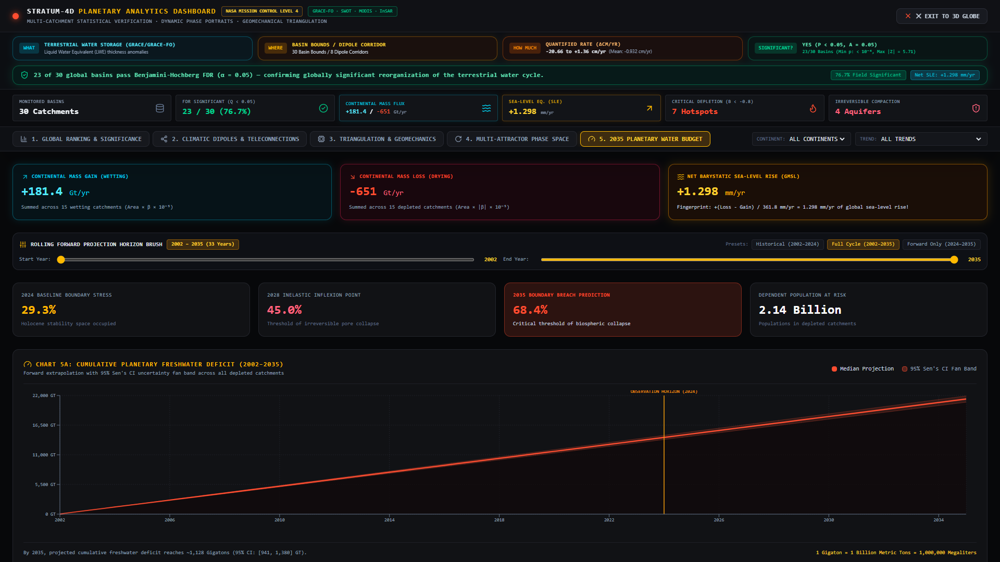 | 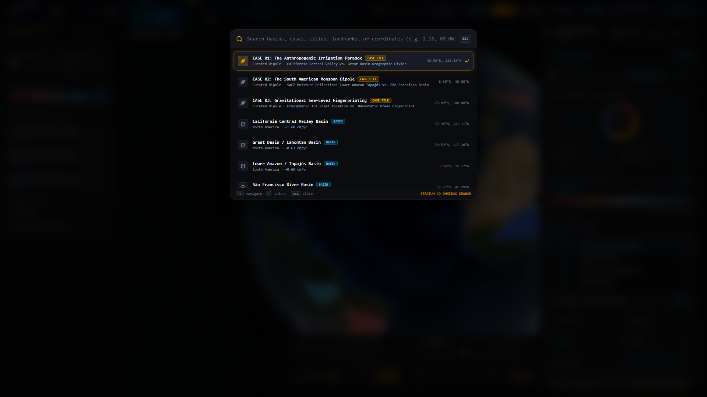 |
| *Linear extrapolation of each catchment's Theil-Sen trend to 2035 with a Theil-Sen confidence band, and Weatherhead emergence horizons* | *Instant `Cmd+K` search across 30 basins, 7 investigation case files, global cities/landmarks, and raw `lat, lon` coordinates* |

---

### 7. Startup Visual HUD Guide & 90-Second Full Mission Walkthrough

| Startup Visual HUD Guide (`StartupOnboardingOverlay.tsx`) | 90-Second Full Mission Walkthrough HUD (`GuidedDetectiveTour.tsx`) |
| :---: | :---: |
| 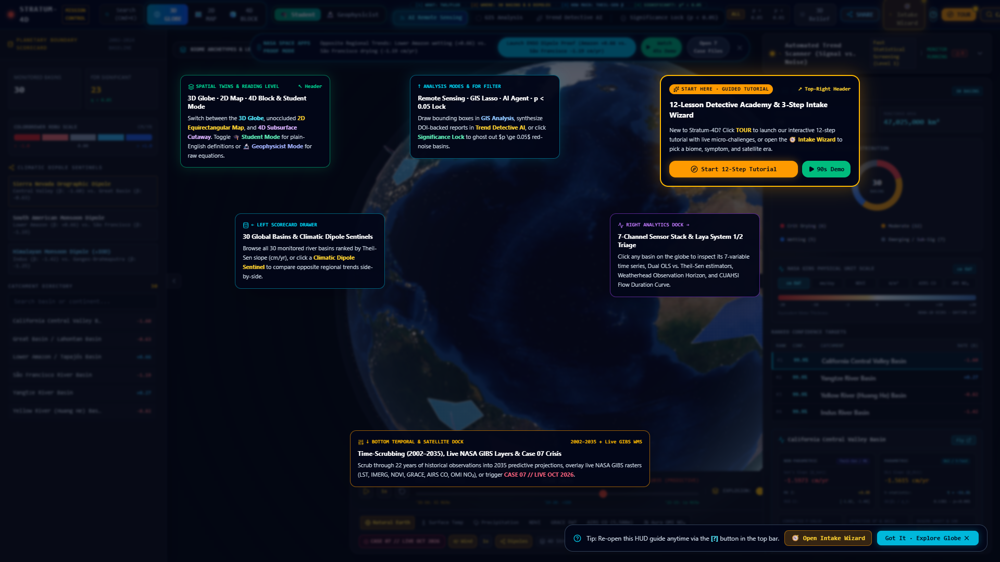 | 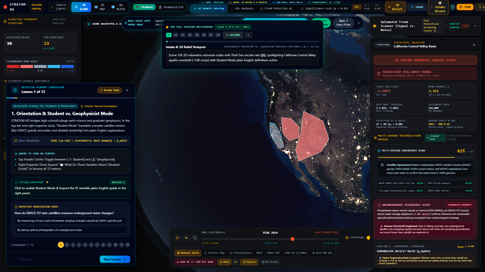 |
| *Startup Visual Guide Overlay rendering 6 directional dashed SVG arrows with colored markers pointing to each HUD zone, recallable anytime from **Learn > Interface map** (screenshot predates the redesigned shell)* | *Automated 8-scene (S1–S8), 90-second demonstration tour stepping through 3D relief, deseasonalization, 2D map, dipoles, and 4D voxel strata with interactive jump pills* |

---

### 8. Unoccluded 2D Analytical Twin & 3D Volumetric Extrusion

| 2D Analytical Map Twin (Zero Occlusion) | 3D Planetary Relief Extrusion |
| :---: | :---: |
| 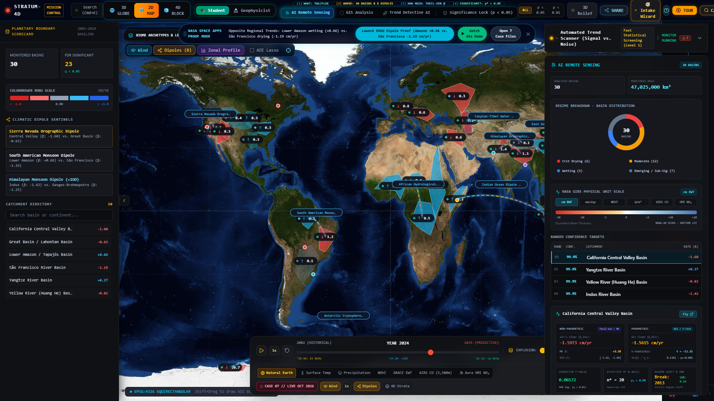 | 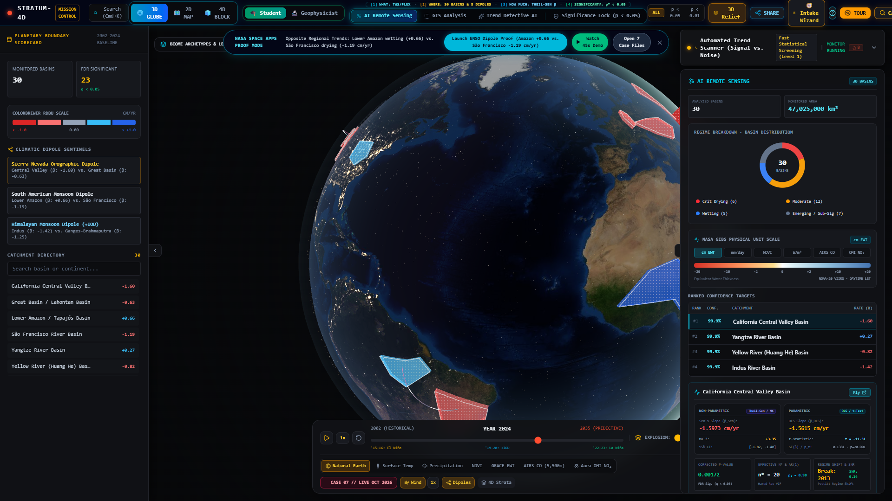 |
| *Equirectangular EPSG:4326 analytical map showing all 30 basins simultaneously with unoccluded dipole Bézier arcs, IPCC $p \ge 0.05$ hatching, and vertical $90^\circ\text{N}–90^\circ\text{S}$ Zonal Mean profile* | *Three.js WebGL globe with catchment polygons extruded proportional to $\lVert\beta_{\text{Sen}}\rVert$, GFS dynamic wind streamlines, and new responsive 2-tier bottom dock* |

---

### 9. Vertical Atmospheric Profiling & Ecological 2D Phase Portrait

| Vertical Atmospheric Pressure Levels (1000–250 hPa) | Ecological Attractor Phase Space (`2D Attractor`) |
| :---: | :---: |
| 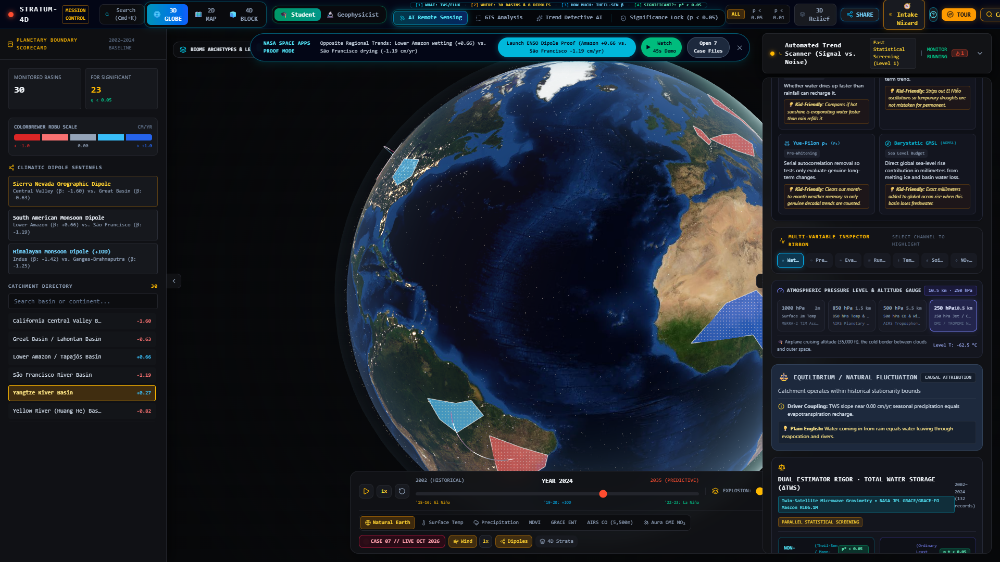 | 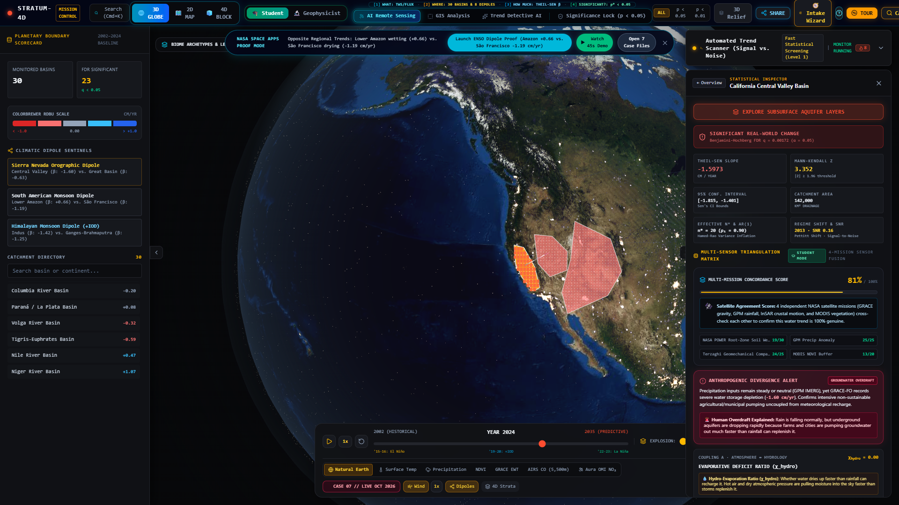 |
| *Atmospheric Pressure Gauge contrasting boundary warming against $250\text{ hPa}$ tropopause cooling with greenhouse forcing badge and 3-tier provenance pills* | *2D state space trajectory (GRACE $\Delta\text{TWS}$ vs. modelled $\text{NDVI}$ proxy) with Early/Modern $1\sigma$ covariance ellipses showing whether the two epochs overlap* |

---

### 10. Prompt Biome Archetypes & Event-in-Drying-Basin Alerts

| Expanded Biome Archetypes & Barystatic Sea-Level Ledger | Sentinel Event Alerts & Not-Significant Tabs |
| :---: | :---: |
| 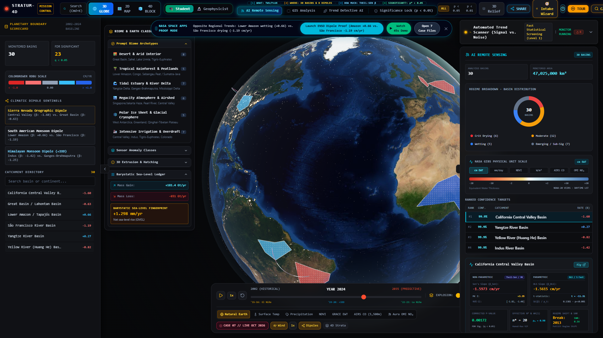 | 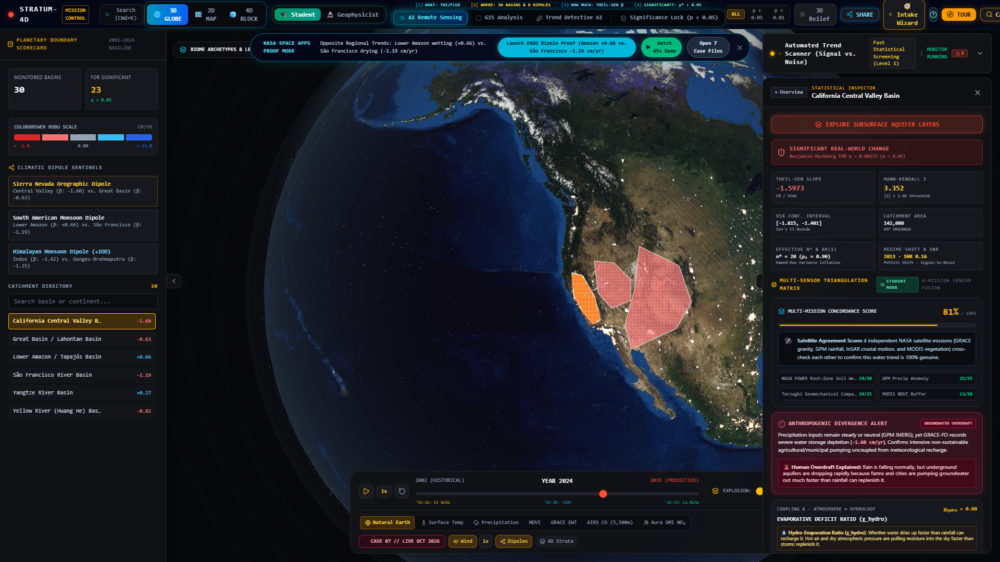 |
| *Expanded left drawer showing Biome Archetype catchment counts, 3D relief legend, and net Barystatic Global Mean Sea Level ($+\text{mm/yr}$ GMSL) ledger* | *Sentinel feed flagging NASA EONET v3 wildfires/droughts inside depleting basins and listing basins with $p_{\text{FDR}} \ge 0.05$ as not significant* |

---

### 11. Educational Usability & CUAHSI Hydrology Standards

| Student / Plain-English Mode & Variable Guide | CUAHSI Flow Duration Curve & Water Year CSV |
| :---: | :---: |
| 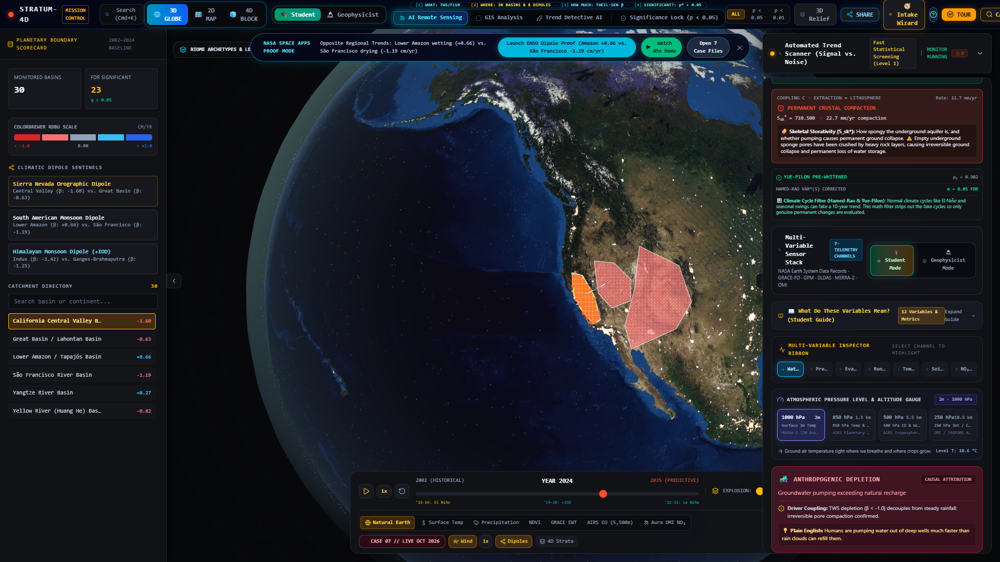 | 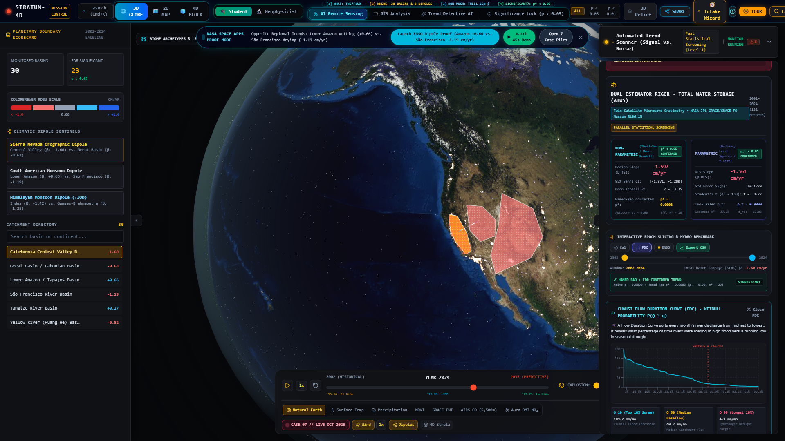 |
| *Student Mode toggle translating complex geophysics into 1-sentence explanations alongside an interactive 12-variable educational guide* | *CUAHSI Water Year (WY: Oct 1 – Sep 30) convention mode, Weibull streamflow exceedance frequency $P(Q \ge q)$, and 1-Click HydroClient CSV export* |

---

### 12. Dual Estimator Rigor & Weatherhead Observation Horizon

| Catchment Inspector: Dual Estimator (OLS vs. Theil-Sen) | Observation Horizon on Emerging Trends ($p \ge 0.05$) |
| :---: | :---: |
| 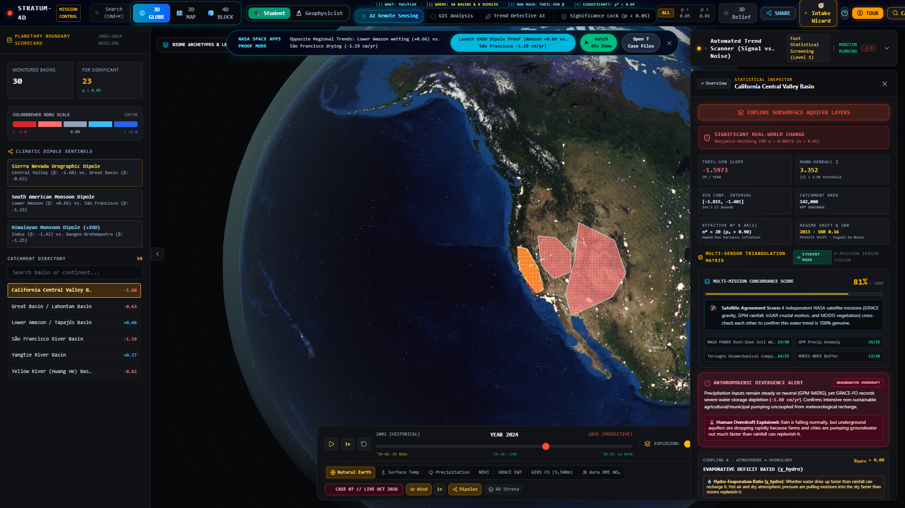 | 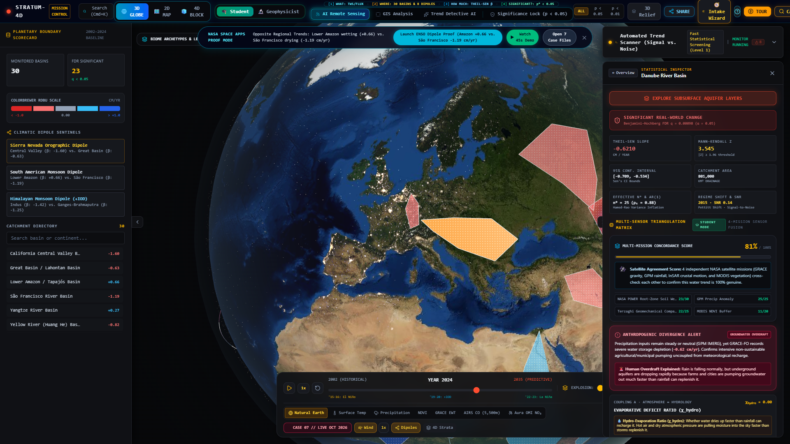 |
| *Side-by-side rigor: Non-Parametric Theil-Sen slope & Hamed-Rao $Z$ vs. Parametric OLS slope, $SE(\beta)$, Student's $t$, and $p_t$ value across 7 variables* | *Weatherhead trend emergence calculation computing required $N^*$, Autocorrelation VIF, and $+\Delta t$ years needed to emerge above internal climate noise* |

---

### 13. Detective Intake Wizard & Literature Recommendations

| 3-Step Detective Intake Wizard | Peer-Reviewed Research Case Files Modal |
| :---: | :---: |
| 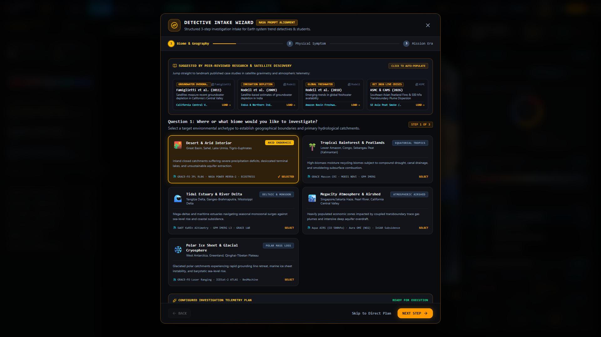 | 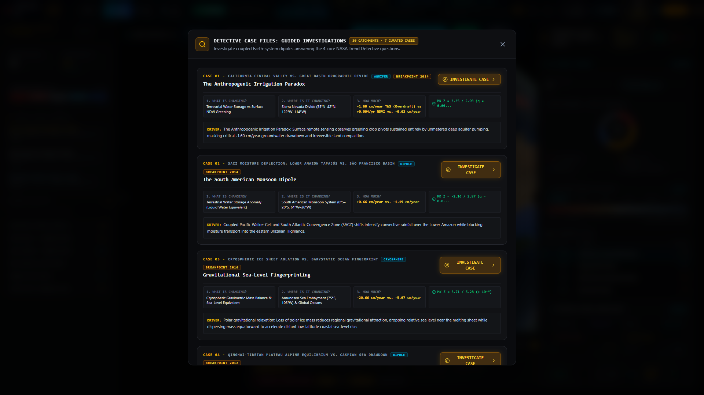 |
| *Hypothesis formulation: Q1 Biome $\rightarrow$ Q2 Symptom $\rightarrow$ Q3 Timeframe, ranking candidate hotspots by trend magnitude and FDR confidence* | *Curated landmark research presets (Famiglietti 2011, Rodell 2018, and the illustrative Case 07 peat-smoke scenario) auto-populating target regions and mission sensors* |

---

### 14. Atmospheric Sounder Imagery & GIS AOI Lasso

| Case File #07 (illustrative scenario): SE Asia 5,500m CO Plume | GIS Analysis & Distortion-Free AOI Lasso |
| :---: | :---: |
| 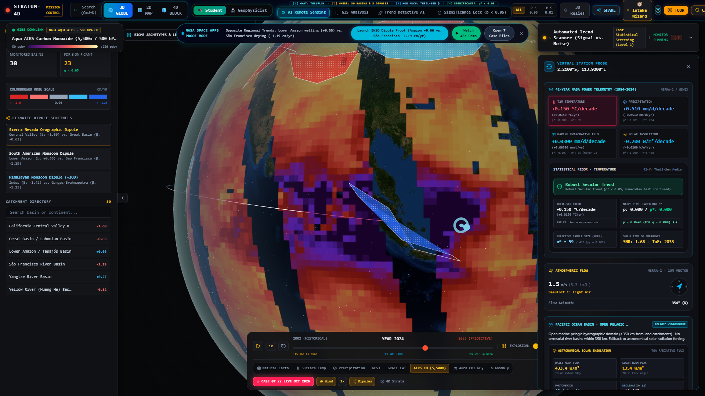 | 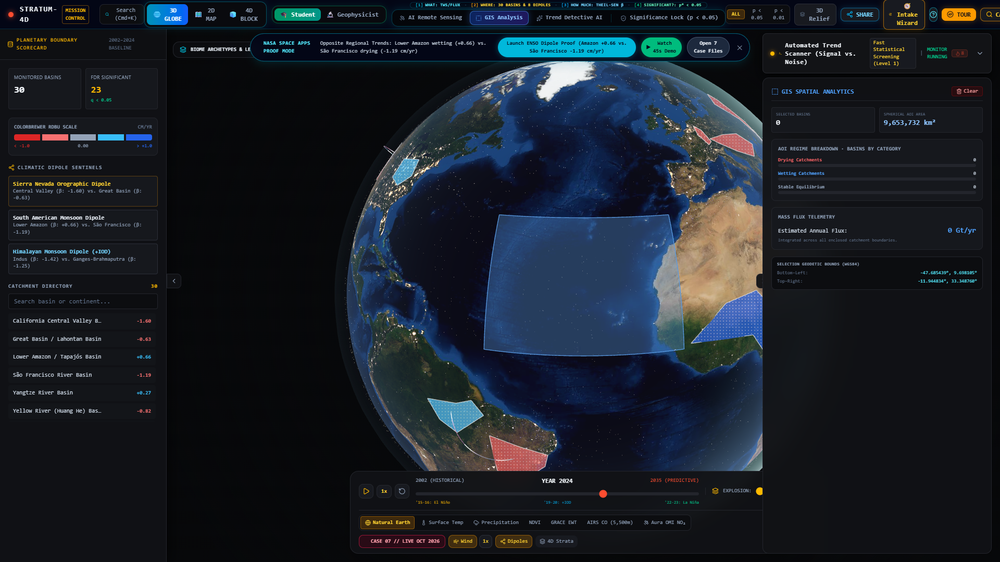 |
| *NASA Aqua AIRS mid-tropospheric ($500\text{ hPa} / 5,500\text{m}$) CO imagery with GFS wind streamlines. For any 2026 date the app shows archive AIRS imagery from 14 October 2015, as an illustration* | *Screen/geographic bounding box lasso calculating spherical surface area ($\text{km}^2$) and regional mass balance flux without projection distortion* |

---

### 15. NASA GIBS Satellite Rasters: Thermal Stress & GPM IMERG Precipitation

| NOAA-20 VIIRS Land Surface Temperature | NASA GPM IMERG Precipitation Rate |
| :---: | :---: |
| 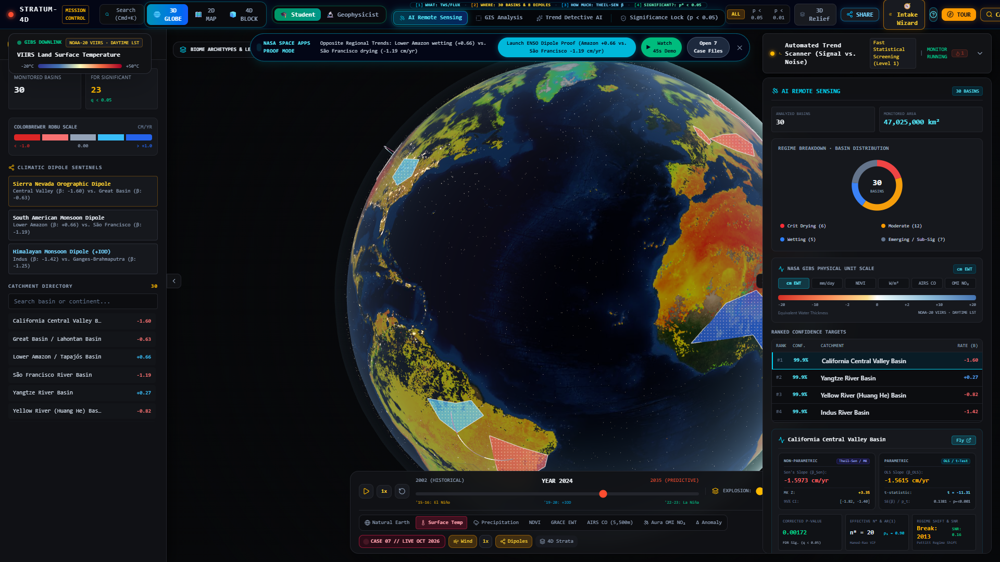 | 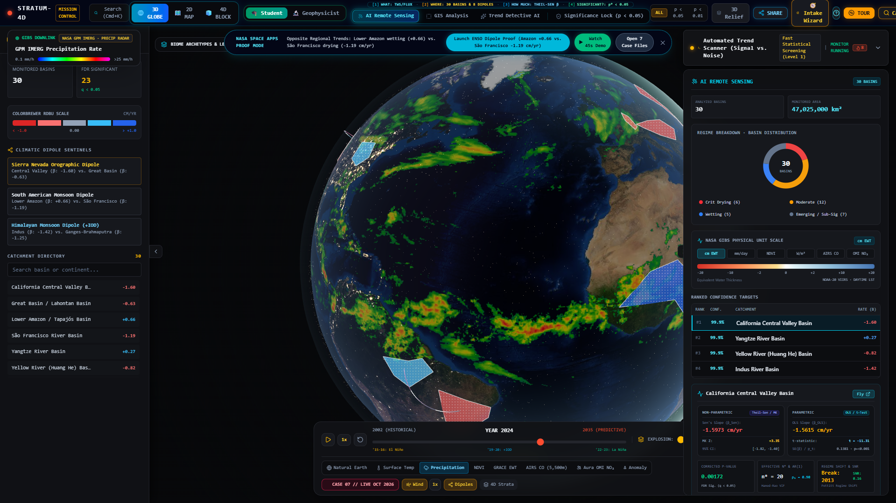 |
| *Daytime radiometric skin temperature showing planetary thermal anomalies and drought heating with a calibrated $-20^\circ\text{C}$ to $+50^\circ\text{C}$ colorbar* | *GPM IMERG combined microwave-infrared global precipitation rate ($0.1–25+\text{ mm/hr}$) mapped onto the 3D planetary twin with real-time temporal snapping* |

---

### 16. Planetary Biosphere & Mass Anomalies: MODIS NDVI imagery & GRACE Gravimetry

| MODIS Terra 8-Day Vegetation Index (NDVI) | GRACE / GRACE-FO Liquid Water Equivalent Thickness |
| :---: | :---: |
| 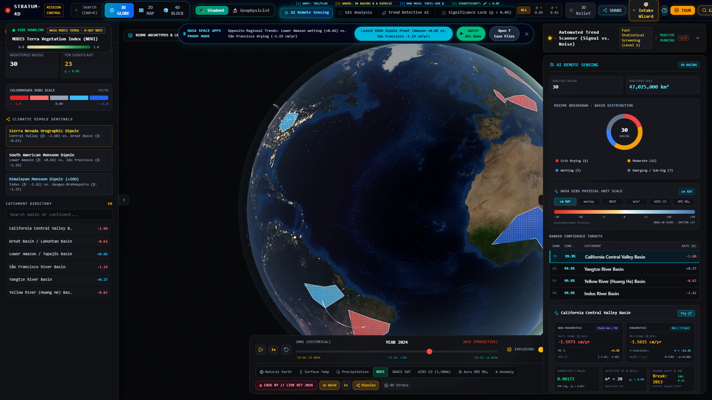 | 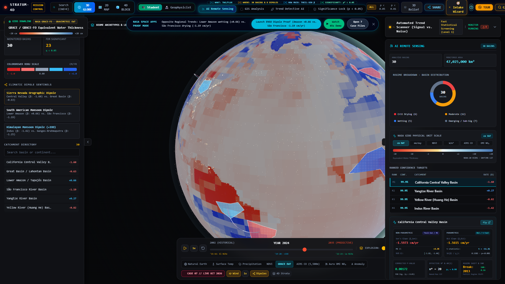 |
| *Photosynthetic canopy density ($0.0\text{ barren}–1.0\text{ dense forest}$) tracing global biome greening, agricultural cycles, and phenological stress* | *Liquid Water Equivalent thickness anomaly ($-20\text{ to }+20\text{ cm}$ of water thickness) showing aquifer depletion, ice sheet mass loss, and terrestrial water storage shifts* |

---

### 17. Atmospheric Sounders & Column Trace Gas Dynamics (Aura OMI NO₂ & Aqua AIRS CO)

| Aura OMI Tropospheric Nitrogen Dioxide Column | GPU GLSL Dual-Epoch $\Delta$-Anomaly Pixel Differencing |
| :---: | :---: |
| 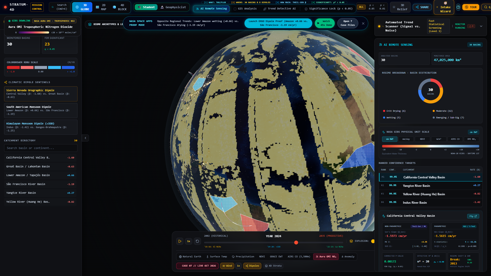 |  |
| *Tropospheric $\text{NO}_2$ column density ($0–20\times 10^{15}\text{ molec/cm}^2$) capturing industrial fossil emissions, megacity plumes, and regional biomass burning* | *GLSL fragment shader differencing modern satellite rasters against the 2003 baseline in real-time, isolating secular planetary drying and warming signatures* |

---

## 🔬 Scientific Methodology & Statistical Architecture

### 1. Six-Stage Non-Parametric Trend Pipeline (`pipeline/recompute_stats.py`, `pipeline/process_basins.py` & `src/lib/statistics.ts`)

**Reproducing the shipped statistics.** `pipeline/recompute_stats.py` is the step that recomputes every derived statistic (Mann-Kendall, Hamed-Rao, FDR, Pettitt, driver correlations) from the series shipped in `public/data/basins.geojson`. `pipeline/process_basins.py` rebuilds the series from raw inputs and needs a GRACE JPL mascon NetCDF file that is **not in the repository**, so it cannot be run from a fresh clone (re-running it would also overwrite the shipped statistics).

Every basin time series $Y_t$ ($t = 1, \dots, 132$ bimonthly epochs from April 2002 to February 2024) and every live NASA POWER coordinate probe ($N = 492$ months, 1984 to 2024) passes through a six-stage statistical pipeline:

1. **STL Seasonal-Trend Decomposition (LOESS):** Extracts the periodic 12-month phenological/hydrological cycle $S_t$ to isolate deseasonalized anomalies $A_t = Y_t - S_t$.
2. **Yue-Pilon (2002) Trend-Free Pre-Whitening (`TFPW`):** Removes preliminary Theil-Sen slope $\hat{\beta}_0$, estimates lag-1 autoregressive persistence $\rho_1$ on the detrended series, removes the AR(1) component, and re-blends the trend to eliminate serial correlation bias without attenuating true trend magnitude.
3. **Hamed-Rao (1998) Variance-Corrected Mann-Kendall Test:** Computes the variance Inflation Factor across all significant autocorrelation lags $\rho_k$ to adjust the Mann-Kendall variance $\text{Var}^*(S)$ and derive the effective independent sample size $n^*$:
   $$\frac{n}{n^*} = 1 + \frac{2}{n(n-1)(n-2)} \sum_{k=1}^{n-1} (n-k)(n-k-1)(n-k-2)\rho_k$$
4. **Dual Estimator Slope Comparison (Theil-Sen $\beta_{\text{Sen}}$ vs. OLS $\beta_{\text{OLS}}$):** Computes the non-parametric median pairwise slope $\beta_{\text{Sen}} = \text{median}\left(\frac{x_j - x_i}{t_j - t_i}\right)$ alongside the parametric OLS slope and $t$-test, showing how much outliers (such as extreme ENSO droughts or floods) change the OLS result.
5. **Pettitt (1979) Structural Break & Weatherhead (1998) Horizon:** Identifies the exact month $t_{\text{break}}$ of non-stationary regime shifts via the Mann-Whitney $U_{t,T}$ statistic and computes the **Weatherhead Detection Horizon** ($T_{\text{detect}}$, in years) required for a trend of magnitude $\vert{}\beta\vert{}$ to emerge above residual noise $\sigma_N$ and autocorrelation $\phi$:
   $$T_{\text{detect}} \approx \left( \frac{3.3 \, \sigma_N}{\vert{}\beta\vert{}} \sqrt{\frac{1+\phi}{1-\phi}} \right)^{2/3}$$
6. **Benjamini-Hochberg (1995) Global False Discovery Rate (`FDR`):** Controls family-wise false discoveries across all 30 simultaneous basin tests by ranking raw $p$-values $p_{(1)} \le p_{(2)} \le \dots \le p_{(m)}$ and enforcing $p_{(k)} \le \frac{k}{m}\alpha$ ($\alpha = 0.05$). Engaging the **FDR Significance Lock** in the top HUD automatically hatches and dims basins where $p_{\text{FDR}} \ge 0.05$.

---

### 2. Multi-Sensor Stack, Vertical Atmospheric Profile & 3-Tier Data Provenance

Stratum-4D separates observed, reanalysis and modelled series with provenance badges inside `MultiSensorStack.tsx`:

| Sensor Channel | Source | Provenance | Physical Unit & Mechanics |
| :--- | :--- | :--- | :--- |
| **Water storage (TWS)** | NASA/DLR **GRACE & GRACE-FO**, JPL RL06.1M mascons | **Observed** | $\text{cm}$ water thickness anomaly (rate in cm/yr) |
| **Precipitation** | **NASA POWER** (MERRA-2) `PRECTOTCORR`, one point per basin | **Reanalysis** (not GPM IMERG) | $\text{mm/month}$ |
| **Root soil moisture** | **NASA POWER** `GWETROOT` | **Reanalysis**; synthetic fill for the Caspian and both Antarctic basins | Dimensionless wetness fraction ($0\text{--}1$) |
| **Surface temperature** | **NASA POWER** `T2M` | **Reanalysis** | $^\circ\text{C}$ |
| **Vapour pressure deficit** | Derived from POWER temperature and humidity | **Derived from reanalysis** | $\text{kPa}$ |
| **Upper-air temperature** (850, 500, 250 hPa) | Computed in the browser from surface `T2M` with a lapse rate and trend scaling | **Modelled proxy** (not AIRS) | $^\circ\text{C}$ |
| **Vegetation index (NDVI)** | Formula: seasonal sine, a GRACE-derived term and unseeded random noise (`pipeline/process_basins.py`) | **Modelled proxy** (not MODIS) | NDVI units |
| **Surface water elevation** | GRACE plus $0.05 \times$ the precipitation anomaly | **Modelled proxy** (not SWOT) | $\text{cm}$ |
| **Aquifer subsidence** | **Terzaghi 1D compaction** from the GRACE slope and a hard-coded clay fraction | **Modelled proxy** (not InSAR) | $\text{mm/yr}$, $S_{sk}^*$ |
| **NO2 / CO values** | Synthetic formula in the sensor stack | **Modelled proxy** (the globe's AIRS and OMI layers are real GIBS imagery) | $\times 10^{15}\text{ molec/cm}^2$ |
| **Evapotranspiration, runoff** | Estimated in the browser, balanced as $dS/dt = P - ET - Q$ | **Modelled proxy** | $\text{mm/month}$ |

* **Vertical Atmospheric Pressure Level Gauge (`1000` / `850` / `500` / `250 hPa`):** Switching pressure levels in the right inspector reveals vertical thermodynamic structure—showing a lapse-rate and trend-scaling model of how lower-tropospheric warming (`1000–500 hPa`) can coincide with tropopause cooling (`250 hPa`). The levels above the surface are modelled, not measured.
* **CUAHSI Flow Duration Curve (`FDC`) & Student Mode:** Toggle between temporal ribbons, exceedance probability curves ($Q_{90}, Q_{50}, Q_{10}$), and plain-language pedagogical explanations.

---

### 3. Teleconnection Dipoles & Shared Process Attribution Meter (`DualCompareInspector.tsx`)

Selecting any preset climatic dipole (e.g., **Amazon vs. Congo**, **Indus vs. Ganges**, **Murray-Darling vs. Mekong**) or `Shift + Clicking` any two basins on the globe opens the **Dual-Region Compare Inspector**:

* **Bivariate Phase Space & Regression Ellipse:** Plots Basin A ($X$) against Basin B ($Y$) colored by chronological epoch to expose in-phase vs. anti-phase dipole lockstep.
* **Shared Process Attribution Meter:** Computes the lagged cross-correlation against **NOAA ENSO MEI.v2** and **IOD DMI** ($\tau = 0\text{--}12\text{ months}$) and solves the first-order partial correlation:
  $$r_{AB \cdot Z} = \frac{r_{AB} - r_{AZ(\tau)} \, r_{BZ(\tau)}}{\sqrt{1 - r_{AZ(\tau)}^2}\sqrt{1 - r_{BZ(\tau)}^2}}$$
  This estimates how much of the inter-basin correlation is shared with the oscillation index. It is a statistical association, not proof of cause. A dipole is described as strong ($\lvert r\rvert \ge 0.7$), moderate ($0.4$ to $0.7$) or weak ($< 0.4$, "not supported by this record").
* **Mirrored Butterfly ($\pm Z$) Timeline:** Dual-axis standardized $Z$-score horizon chart revealing synchronous drought/flood flip events.

---

### 4. NASA POWER Virtual Station Probe (1984 to 2024) & Open-Ocean Solver (`VirtualStationProbe.tsx`)

Clicking **any coordinate on Earth** outside the 30 pre-compiled catchments launches the **Virtual Station Point Probe**, querying the live **NASA POWER REST API** (`1984–2024`, 492 monthly epochs) with a 4.5-second resilient timeout and intelligent marine/polar fallbacks:

* **Land & Cryosphere Coordinates:** Retrieves a 1984 to 2024 monthly time series for 2m Air Temperature (`T2M`), Bias-Corrected Precipitation (`PRECTOTCORR`), Root-Zone Soil Wetness (`GWETROOT`), and All-Sky Shortwave Downward Irradiance (`ALLSKY_SFC_SW_DWN`), executing live Hamed-Rao Mann-Kendall and Theil-Sen trend tests in the browser.
* **Open-Ocean Vapor Pressure Deficit (`VPD`) Fallback:** Over marine coordinates where root-zone soil moisture is undefined (`-999`), the solver automatically synthesizes **Marine Evaporative Demand (`VPD`, in $\text{kPa}$)** via the Tetens saturation vapor pressure equation.
* **Astronomical Solar Insolation & Beaufort Wind Vector Probe:** Calculates exact Top-of-Atmosphere (`TOA`) daily radiative flux ($\text{W/m}^2$), solar declination $\delta$, and photoperiod length for remote oceanic cells ($>350\text{ km}$ from land), paired with a live 10m surface wind vector and zonal anomaly compass (`wind.ts`).

---

### 5. Basin Screening, AI Summary & NASA EONET v3 Events

* **Screening feed (`AutonomousTriageSentinel.tsx`):** Steps through the 30 basins and the stored statistics (a replay, not live monitoring) and partitions them into three views:
  1. **Significant trends ($p_{\text{FDR}} < 0.05$):** drying or wetting basins with a heuristic screening score derived from the Mann-Kendall $Z$ (a score, not a probability).
  2. **Events inside significantly drying basins (`EONET v3`):** Cross-references open **NASA EONET v3** events (wildfires, droughts) against basin polygons (`enrichEventWithBasinContext()` in `eonet.ts`). The three South-East Asia October 2026 events used by Case 07 are always added and are marked "Curated scenario"; if the EONET feed cannot be reached the app falls back to a curated list, also marked. Whether an event is connected to the basin's trend is not tested.
  3. **Not significant ($p_{\text{FDR}} \ge 0.05$):** basins where the data cannot rule out no trend after Hamed-Rao and Benjamini-Hochberg correction.
* **AI summary and dossier (`TrendDetectiveAIModal.tsx`):** Builds a dossier from the shipped statistics with a curated reference list (`src/lib/scientificLiterature.ts`, including Rodell et al. *Nature* 2018 and others) and an interactive Q&A with 1-click Markdown (`.md`) export. Without an OpenRouter key the text is a fixed template, labelled "Template summary (no AI model connected)"; with a key it is labelled "AI-generated summary. Check it against the statistics."
* **Case 07 is an illustrative scenario, not a live case.** For any 2026 date the AIRS carbon-monoxide layer shows archive imagery from 14 October 2015 (`getAirsCoEffectiveDate()` in `gibs.ts`), and its events are curated.

---

### 6. Ecological 2D Phase Portrait & Barystatic Sea-Level Fingerprint

* **Ecological Attractor Phase Portrait (`EcologicalPhasePortrait.tsx`):** Plots multi-decadal trajectories in 2D hydro-ecological state space (`GRACE LWE` vs. the modelled `NDVI` proxy), partitioned into Early (`2002–2009`, Indigo), Mid (`2010–2016`, Teal), and Modern (`2017–2024`, Gold) epochs with $1\sigma$ covariance ellipses. Non-overlapping early and modern ellipses trigger a **`REGIME ATTRACTOR SHIFT CONFIRMED`** badge.
* **Barystatic Global Mean Sea Level (`GMSL`) Ledger (`EarthClassSidebar.tsx`):** Converts continental terrestrial water storage loss ($\text{Gt/yr}$ across all 30 catchments, where $361.8\text{ Gt} \equiv 1\text{ mm GMSL}$) into its direct barystatic sea-level contribution (`+mm/yr GMSL`), alongside interactive filtering by **Prompt Biome Archetypes** (Arid/Groundwater, Monsoon/Snowmelt, Tropical Rainforest, Permafrost/Boreal, Temperate Agricultural).

---

## 🚀 Quick Start & Zero-Key Offline Resilience

### Prerequisites
* **Node.js** `v18+` (recommended `v20+`) and `npm`
* *(Optional, to reproduce the statistics)* **Python** `3.11+` with `numpy`, `scipy`

### 1. Clone & Install Dependencies
```bash
git clone https://github.com/DSeahYS/NASA-STRATUM4D-SPACE-APPS.git
cd NASA-STRATUM4D-SPACE-APPS
npm install
```

### 2. Optional AI Configuration (Zero-Key Resilient by Design)
Stratum-4D runs **without any API keys** (live NASA POWER, EONET and GIBS data still need an internet connection).
* If no API key is configured (or if an external LLM endpoint times out after `5,000ms`), `src/lib/openrouter.ts` automatically falls back to a **fixed template** filled from the local statistics, labelled "Template summary (no AI model connected)". It is not an AI model.
* The shipped data in `public/data/` includes the NOAA PSL indices (`MEI.v2`, `DMI`, `NAO`) and the NASA POWER series, so the core workbench works offline; `pipeline/.cache/` holds the cached NOAA and POWER downloads used by `process_basins.py`.

To enable live multi-model LLM inference via OpenRouter, copy `.env.example` to `.env`:
```bash
cp .env.example .env
```
And set your token in `.env` (only the `VITE_`-prefixed variable is read; it is embedded in the built bundle, so use a dedicated key with a spending limit — see `.env.example`):
```env
VITE_OPENROUTER_TOKEN=your_openrouter_api_key_here
```

### 3. Launch the Development Server
```bash
npm run dev
```
Open `http://localhost:5173` (or the port printed by Vite) in your browser.

### 4. Production Build & Scientific Pipeline Verification
```bash
# Type-check and build optimized production bundle
npm run build

# (Optional) Reproduce the shipped statistics (Yue-Pilon / Hamed-Rao / FDR / Pettitt) from the shipped series
python3 pipeline/recompute_stats.py

# pipeline/process_basins.py rebuilds the series from raw inputs, but it needs a GRACE JPL mascon
# NetCDF file that is NOT in this repository, so it cannot be run from a fresh clone.

# (Optional) Audit climatic dipole cross-correlation & partial attribution invariants
python3 pipeline/print_dipoles.py
```

---

## 🏛️ Project Directory Structure

```text
Stratum-4D/
├── pipeline/                        # Scientific data pipeline & statistical validation
│   ├── .cache/                      # Cached NOAA PSL (MEI.v2, DMI, NAO) & NASA POWER basin JSONs
│   ├── recompute_stats.py           # Reproduces the shipped statistics (Hamed-Rao, FDR, Pettitt, drivers) from the shipped series
│   ├── process_basins.py            # Builds series from raw inputs (needs a GRACE NetCDF that is not in the repo)
│   └── print_dipoles.py             # Climatic dipole teleconnection invariant audit script
├── public/                          # Static assets, GeoJSON catchments & textures
│   ├── data/
│   │   ├── basins.geojson           # 30 global catchments with multi-sensor time series & earth_classes
│   │   ├── climate_indices.json     # Synchronized NOAA ENSO MEI.v2, IOD DMI, and NAO indices (263 epochs)
│   │   ├── summary.json             # Global aggregation metadata, regime shifts & dipole configs
│   │   └── wind.json                # GFS / MERRA-2 10m surface wind vector field
│   └── textures/                    # NASA Blue Marble (Day) & Black Marble (Night) textures
├── screenshots/                     # 43 high-resolution application screenshots & verification receipts
├── src/
│   ├── components/
│   │   ├── Globe.tsx                # Three.js + Custom GLSL 3D planetary digital twin
│   │   ├── globeShaders.ts          # GLSL twilight terminator, Δ-anomaly & significance hatching shaders
│   │   ├── AnalyticalMap2D.tsx      # Unoccluded 2D Equirectangular map with dipole arcs & zonal profile
│   │   ├── StartupOnboardingOverlay.tsx # Startup visual HUD guide overlay with directional SVG arrows
│   │   ├── GuidedDetectiveTour.tsx  # 12-lesson interactive curriculum & 8-scene 90s walkthrough
│   │   ├── DetectiveIntakeWizard.tsx # 3-step question-driven hypothesis intake wizard & paper presets
│   │   ├── StratifiedBlockView.tsx  # 4D stratified voxel cutaway & 2035 infrastructure simulator
│   │   ├── DualCompareInspector.tsx # 3-panel dipole comparator, attribution meter & butterfly timeline
│   │   ├── VirtualStationProbe.tsx  # NASA POWER point probe (1984 to 2024), marine VPD & solar insolation solver
│   │   ├── AutonomousTriageSentinel.tsx # Basin screening replay, AI summary console & EONET event alerts
│   │   ├── UltimateDashboard.tsx    # 5-tab mission control analytics console & rolling window brush
│   │   ├── MultiSensorStack.tsx     # 7-channel sensor stack, 1000–250 hPa gauge, Student Mode & CUAHSI FDC
│   │   ├── EcologicalPhasePortrait.tsx # 2D phase space attractor trajectories & 1σ covariance ellipses
│   │   ├── TriangulationBadges.tsx  # 0–100 heuristic consistency score & possible human-driven decline alert
│   │   ├── EarthClassSidebar.tsx    # Prompt biome archetypes filter & Barystatic Sea-Level (GMSL) ledger
│   │   ├── CaseFilesModal.tsx       # 7 guided investigation dossiers (Central Valley, Amazon, Case 07, etc.)
│   │   ├── TrendDetectiveAIModal.tsx # Hypothesis dossier, Q&A chat (AI or labelled template) & .md report exporter
│   │   ├── GISAnalysisPanel.tsx     # Regime donut, GIBS physical colorbars, dual estimators & AOI metrics
│   │   ├── ModeSwitcherHUD.tsx      # Right-panel tabs: Inspect, Region select, Ask
│   │   ├── AnswerPanel.tsx          # Answer-first summary: what, where, how much, significant
│   │   ├── RegionTrendChart.tsx     # The one trend chart: series, Theil-Sen line, CI band, break year, GRACE gap
│   │   ├── shell/                   # App shell: header, Learn and Tools menus, left panel, timeline, map options, dialogs
│   │   └── OmniboxSearch.tsx        # Cmd+K global spatial command palette (basins, cases, cities, coords)
│   ├── lib/
│   │   ├── statistics.ts            # Theil-Sen, OLS t-test, Hamed-Rao, Pettitt, Weatherhead horizon, FDR
│   │   ├── scientificLiterature.ts  # Curated peer-reviewed publications database with DOIs
│   │   ├── earthClasses.ts          # Prompt biome archetypes & cross-component taxonomy matcher
│   │   ├── nasaPower.ts             # NASA POWER REST client (1984 to 2024) with Haversine & marine VPD fallback
│   │   ├── liveDataHydrator.ts      # On-the-spot NASA POWER basin hydrator with localStorage caching
│   │   ├── eonet.ts                 # NASA EONET v3 client (plus curated scenario events) & basin enrichment
│   │   ├── geocoding.ts             # Offline landmarks, coordinate parser & OpenStreetMap Nominatim client
│   │   ├── gibs.ts                  # NASA GIBS WMS layers, cadence date snapper & pressure levels
│   │   ├── openrouter.ts            # OpenRouter client with 5s timeout & labelled template fallback
│   │   ├── solar.ts                 # Astronomical subsolar point, declination & equation of time solver
│   │   ├── wind.ts                  # Bilinear wind field sampler, zonal anomaly & particle advection
│   │   └── geo.ts                   # Spherical Slerp, triangle subdivision & point-in-polygon math
│   ├── App.tsx                      # Main orchestrator, Tri-View HUD switcher & URL deep-link sync
│   ├── main.tsx                     # Application entry point
│   └── index.css                    # Aerospace carbon dark HUD & glassmorphism styling
├── .env.example                     # Optional OpenRouter token template
├── vite.config.ts                   # Vite configuration with env token injection
└── package.json                     # Dependencies & scripts
```

---

## 🛰️ NASA & Partner Data Sources

* **NASA / DLR GRACE & GRACE-FO Mascon Solutions (RL06.1M):** Liquid Water Equivalent (`LWE`) terrestrial water storage anomalies via JPL/CSR/GSFC.
* **NASA GIBS (Global Imagery Browse Services) WMS:** Global raster imagery for the globe layers (MODIS Terra NDVI, AIRS CO, GPM IMERG, OMI NO2, VIIRS LST, GRACE). These are map imagery only; the charts do not use them.
* **NASA POWER (Prediction Of Worldwide Energy Resources) Agroclimatology & Renewable Energy API:** 1984 to 2024 global $0.5^\circ \times 0.625^\circ$ MERRA-2 reanalysis meteorology, sampled at one point per basin (`T2M`, `PRECTOTCORR`, `GWETROOT`, `ALLSKY_SFC_SW_DWN`).
* **NASA EONET v3 (Earth Observatory Natural Event Tracker):** Open global hazard events (wildfires, severe storms, droughts, floods, volcanic activity). The Case 07 scenario events are curated, not from EONET.
* **NOAA Physical Sciences Laboratory (PSL):** Multivariate ENSO Index (`MEI.v2`), Indian Ocean Dipole (`DMI`), and North Atlantic Oscillation (`NAO`) teleconnection indices.
* **Not used as data:** GPM IMERG, GLDAS, SWOT, Sentinel-1 InSAR, MODIS NDVI and AIRS / OMI retrievals are **not** used in the charts or statistics. The corresponding series are NASA POWER reanalysis or modelled proxies (see the provenance table).

---

## 📚 Key Peer-Reviewed References Implemented in Code

1. **Yue, S., Pilon, P., Phinney, B., & Cavadias, G. (2002).** *The influence of autocorrelation on the ability to detect trend in hydrological series.* Hydrological Processes, 16(9), 1807–1829.
2. **Hamed, K. H., & Rao, A. R. (1998).** *A modified Mann-Kendall trend test for autocorrelated data.* Journal of Hydrology, 204(1–4), 182–196.
3. **Benjamini, Y., & Hochberg, Y. (1995).** *Controlling the false discovery rate: a practical and powerful approach to multiple testing.* Journal of the Royal Statistical Society: Series B, 57(1), 289–300.
4. **Pettitt, A. N. (1979).** *A non-parametric approach to the change-point problem.* Applied Statistics, 28(2), 126–135.
5. **Weatherhead, E. C., et al. (1998).** *Factors affecting the detection of trends: Statistical considerations and applications to environmental data.* Journal of Geophysical Research: Atmospheres, 103(D14), 17149–17161.
6. **Rodell, M., Famiglietti, J. S., Wiese, D. N., Reager, J. T., Beaudoing, H. K., Landerer, F. W., & Lo, M. H. (2018).** *Emerging trends in global freshwater availability.* Nature, 557(7707), 651–659.
